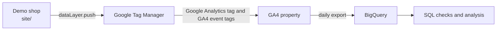

# GA4 measurement pipeline

A small, end-to-end GA4 implementation for a fictional outdoor shop, Northwind Outdoor. It starts from business requirements, turns them into a tracking plan, implements the events on a demo site through Google Tag Manager and exports the data to BigQuery for analysis.

- **Demo shop:** https://victorpolitakis.github.io/ga4-measurement-pipeline/
- **Requirements (BRD):** [docs/01_BRD.md](docs/01_BRD.md)
- **Tracking plan and data dictionary:** [docs/02_tracking_plan.md](docs/02_tracking_plan.md)
- **Deployment guide:** [docs/03_deployment_guide.md](docs/03_deployment_guide.md)
- **Troubleshooting runbook:** [docs/04_troubleshooting_runbook.md](docs/04_troubleshooting_runbook.md)
- **SQL results on Google's public GA4 sample:** [sql/public/RESULTS.md](sql/public/RESULTS.md)
- **Build log** (what broke and how it was fixed): [docs/build_log.md](docs/build_log.md)

## Data flow



The site never calls GA4 directly. It pushes events to the `dataLayer`, and GTM decides what to send. That keeps tag changes out of the site code and gives every change a version that can be rolled back.

## Events

Event names follow GA4 recommended events where one exists, so the built-in ecommerce reports work without extra setup.

| Event | Fires when | Key parameters |
|---|---|---|
| `view_item` | A product page loads | `items`, `value`, `currency` |
| `add_to_cart` | "Add to cart" is clicked | value of the added item only |
| `begin_checkout` | The checkout page loads with a non-empty cart | whole cart |
| `purchase` | The order confirmation is shown | unique `transaction_id`, not re-sent on refresh |
| `generate_lead` | The B2B contact form is accepted by the server | `lead_type`, `value`, `currency`, no personal data |
| `cta_click` | A hero or promo button is clicked | `cta_id`, `cta_text` |

All four ecommerce events also carry `item_count`, the number of units in `items`. `page_view` and `file_download` come from the Google Analytics tag and enhanced measurement. Full definitions are in the [tracking plan](docs/02_tracking_plan.md).

## GTM container

| Type | What's in it |
|---|---|
| Tags | Google Analytics tag on Initialization – All Pages; one GA4 event tag for the four ecommerce events (event name from `{{Event}}`, ecommerce data from the data layer); one tag each for `generate_lead` and `cta_click` |
| Triggers | Custom Event triggers. The ecommerce one uses an anchored regex, `^(view_item\|add_to_cart\|begin_checkout\|purchase)$`, because GTM's regex matching is partial |
| Variables | Data Layer Variables for the event parameters, and a Custom JavaScript variable that counts item quantities |

Every change went through Preview, Tag Assistant and GA4 DebugView before it was published as a named version.

## Consent

Consent Mode v2 in advanced mode. `site/js/consent.js` runs before GTM and sets every consent signal to denied until the visitor picks Accept all, Analytics only or Reject all. Before a choice, Google tags send cookieless pings and set no `_ga` cookie; after Accept all, cookies are set and hits carry `gcs=G111`. Tag Assistant screenshots of the three choices are in [docs/img](docs/img).

## Traffic

All traffic in the GA4 property is synthetic or from testing; no real person visits the shop. `qa/traffic.py` simulates a mock campaign, `autumn_tents`, from three sources (`google / cpc`, `newsletter / email`, `instagram / social`). Each simulated visitor gets a fresh browser, makes a random consent choice and goes some way down the funnel; some send the B2B form, one with a server error. The script writes what every visitor did to a CSV in `qa/output/`, and `qa/reconcile.py` compares that ground truth with what reached BigQuery.

First run (150 visitors): 24 purchases, 13 of them with analytics consent. GA4 Realtime showed exactly those 13. In BigQuery all 24 are there, the 11 without consent as cookieless events with no source, so almost half of the campaign's purchases can't be attributed. The reconciliation also caught that every `cta_click` and `add_to_cart` from the run was missing: a quirk of Playwright-driven Chromium, which doesn't fire `pagehide`, so gtag never sent its batch. Details: [sql/own/RESULTS.md](sql/own/RESULTS.md).

## SQL

- `sql/public/`: funnel, channels, revenue by item, duplicate transactions, and two window-function queries (`ROW_NUMBER`, `LAG`) over the 4.3M events of Google's public GA4 sample. Results and what they show: [RESULTS.md](sql/public/RESULTS.md).
- `sql/own/`: consent rate, campaign attribution and events by consent state on this project's own export.

## QA

```bash
python3 -m venv .venv && .venv/bin/pip install -r qa/requirements.txt && .venv/bin/python -m playwright install chromium
.venv/bin/python qa/tag_qa.py      # GA4 hits across consent states, funnel, leads, PII (sends nothing to GA4)
.venv/bin/python qa/mp_validate.py # Measurement Protocol payloads against the debug endpoint (needs GA4_API_SECRET in .env)
.venv/bin/python qa/bq_checks.py   # data quality on the BigQuery export (needs gcloud auth login)
```

Latest `tag_qa.py` run: 21 checks passed, 0 failed. `qa/reconcile.py` compares a traffic run's CSV with the export; `qa/bq_checks.py`: 7 of 7 passed.

## Repository layout

```
site/   demo shop (HTML, CSS, JS), deployed to GitHub Pages
docs/   BRD, tracking plan, deployment guide, runbook, build log, screenshots
sql/    BigQuery queries: public/ on Google's sample, own/ on this project's export
qa/     tag QA, Measurement Protocol validation, BigQuery checks, synthetic traffic
```

## Run locally

```bash
cd site && python3 -m http.server 8000
```

Then open http://localhost:8000.
