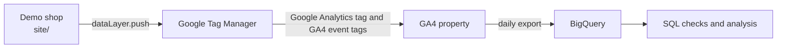

# GA4 measurement pipeline

A small, end-to-end GA4 implementation for a fictional outdoor shop, Northwind Outdoor. It starts from business requirements, turns them into a tracking plan, implements the events on a demo site through Google Tag Manager and exports the data to BigQuery for analysis.

- **Demo shop:** https://victorpolitakis.github.io/ga4-measurement-pipeline/
- **Requirements and tracking plan:** [docs/01_BRD_and_tracking_plan.md](docs/01_BRD_and_tracking_plan.md)
- **Build log** (what broke and how it was fixed): [docs/build_log.md](docs/build_log.md)

## Data flow



The site never calls GA4 directly. It pushes events to the `dataLayer`, and GTM decides what to send. That keeps tag changes out of the site code and gives every change a version that can be rolled back.

## Events

Event names follow GA4 recommended events where one exists, so the built-in ecommerce reports work without extra setup.

| Event | Fires when | Key parameters |
|---|---|---|
| `view_item` | A product page loads | `items`, `value`, `currency` |
| `add_to_cart` | "Add to cart" is clicked | value of the added item only |
| `begin_checkout` | The checkout page loads with a non-empty cart | whole cart |
| `purchase` | The order confirmation is shown | unique `transaction_id`, not re-sent on refresh |
| `generate_lead` | The B2B contact form is accepted by the server | `lead_type`, `value`, `currency`, no personal data |
| `cta_click` | A hero or promo button is clicked | `cta_id`, `cta_text` |

All four ecommerce events also carry `item_count`, the number of units in `items`. `page_view` and `file_download` come from the Google Analytics tag and enhanced measurement. Full definitions are in the tracking plan.

## GTM container

| Type | What's in it |
|---|---|
| Tags | Google Analytics tag on Initialization – All Pages; one GA4 event tag for the four ecommerce events (event name from `{{Event}}`, ecommerce data from the data layer); one tag each for `generate_lead` and `cta_click` |
| Triggers | Custom Event triggers. The ecommerce one uses an anchored regex, `^(view_item\|add_to_cart\|begin_checkout\|purchase)$`, because GTM's regex matching is partial |
| Variables | Data Layer Variables for the event parameters, and a Custom JavaScript variable that counts item quantities |

Every change went through Preview, Tag Assistant and GA4 DebugView before it was published as a named version.

## Status

Done: the tracking plan, the demo shop and its data layer, the GTM container, the GA4 configuration (key events, custom dimensions) and the daily BigQuery export.

Next: Consent Mode v2, SQL analysis in BigQuery, automated tag QA in Python, and a deployment guide with a troubleshooting runbook.

## Repository layout

```
site/   demo shop (HTML, CSS, shop.js), deployed to GitHub Pages
docs/   requirements, tracking plan, build log
```

## Run locally

```bash
cd site && python3 -m http.server 8000
```

Then open http://localhost:8000.
